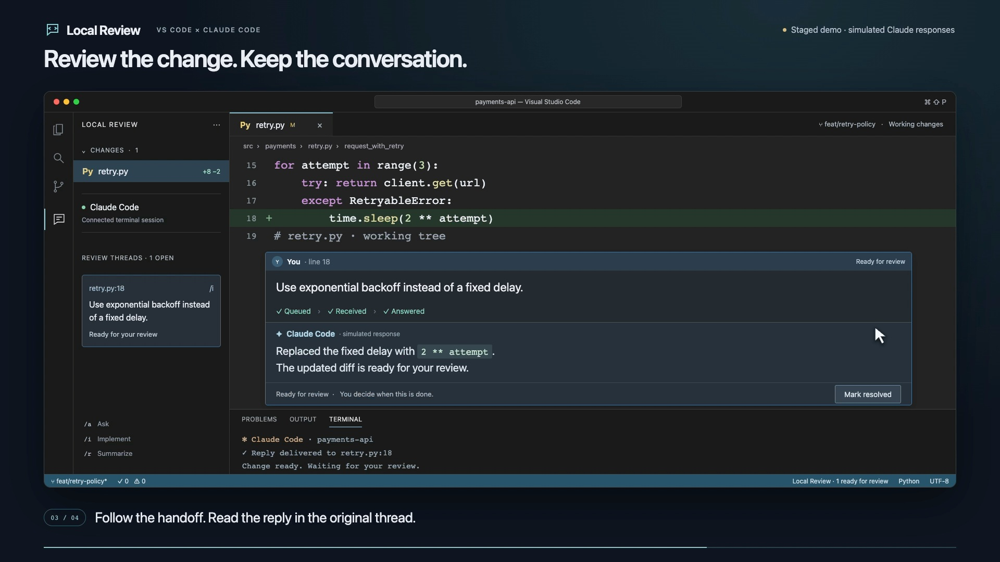
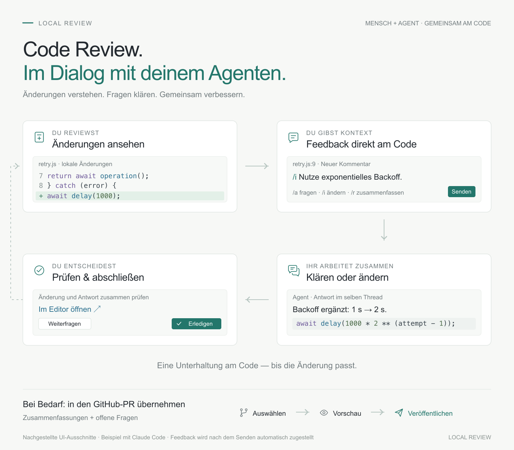

# Local Review

### Review local code. Give Claude feedback where it belongs.

GitHub-style review conversations, directly in VS Code. Select a line in your local changes, ask a question or request a change, and send it straight to Claude Code in your terminal. Replies return to the same inline thread.

[Install the preview](docs/INSTALL.md) · [Download a VSIX](https://github.com/flucas96/local-review/releases) · [Report an issue](https://github.com/flucas96/local-review/issues/new/choose)

**Demo:** staged interface with simulated Claude responses, showing the optional side composer. The default input is now native inline comments. It is not a recording of a verified live integration.

## A review that becomes a conversation

Open a diff, leave feedback, and keep reviewing. Each submitted comment reaches your connected agent automatically—there is no separate review submission.

| Action | What Claude is asked to do |
| --- | --- |
| **Ask `/a`** | Explain a decision or discuss the code. |
| **Implement `/i`** | Make the requested change, then return it for your review. |
| **Summarize `/r`** | Condense the conversation and its remaining decisions. |

Native VS Code comments keep the conversation next to the code. The Review sidebar shows what is waiting, received, in progress, or ready for you. Claude can reply and report progress; **you decide when a thread is resolved**.

Use the **✓** on a thread or Review list entry to resolve it. Completed conversations disappear from the editor and list. The Review toolbar's **eye** shows them again; **Wieder öffnen** restores an active thread. Nothing is deleted.

Write directly beside the changed code: click the gutter **+**, enter `/a`, `/i`, or `/r` followed by your feedback, then use the single **Senden** action. The prefix determines the mode when sending. Existing threads have a native reply field, so the conversation stays attached to its code.

Prefer a separate input? **Local Review: Feedback in Seitenansicht schreiben** opens a compact composer with live mode buttons, saved drafts and selection following. Keep it open and select the next code block; an empty draft follows without moving focus. Written drafts stay pinned and offer an explicit switch. The selected lines remain outlined when you click into the composer. Closing it keeps drafts for **Local Review: Entwurf fortsetzen**. Native inline draft recovery remains managed by VS Code.

**Speak on macOS:** click the input, type `/a` or `/i`, then use your Mac's Microphone key or Dictation shortcut. Review the text and choose **Senden**. [Dictation guide →](docs/DICTATION.md)

Code blocks appear in darker rounded cards with a compact file/language header and VS Code's syntax colors; missing fence languages inherit the review file's language for display. Choose the small **editor icon** in the reply header beside the author or beside the composer's code preview (hover for its label) to use the real editor. Replies with several code blocks offer a compact picker. A confirmed unique match opens the current project file, where hover, Cmd/Ctrl-click and F12 work through your installed language support. Proposed or ambiguous code opens as a clearly labeled, read-only code preview with limited project navigation. The chat and draft stay in place. Inline Markdown blocks remain display-only. Clearly recognized, standalone JavaScript/TypeScript imports and exported functions receive display-only code boxes even in older replies. This includes attached JSDoc and an isolated documented function header; missing bodies are never invented. Ambiguous text remains prose.

## Carry the conversation into your PR

Use the **An GitHub-PR übergeben** action in the Review toolbar. Local Review finds the current branch's open PR and prepares an editable preview of available summaries and unresolved questions. Select the content, inspect the exact PR and text, then explicitly publish it. Later handoffs update your managed review comment instead of adding a duplicate.

`/r` still summarizes a local conversation; it never publishes to GitHub. The first handoff uses a PR discussion comment with captured code locations, because local changes may not match the pushed PR's diff lines. Publishing requires the [GitHub CLI](https://cli.github.com/) installed and signed in. [PR handoff guide →](docs/PR-HANDOFF.md)

## Start in a minute

Download a `.vsix` from [GitHub Releases](https://github.com/flucas96/local-review/releases), then choose **Extensions → … → Install from VSIX…** in VS Code. The extension is not published on the Marketplace yet.

Open a trusted local Git repository and run **Local Review: Mit Claude verbinden**. Choose a new conversation or continue the last one. Open **Local Review: Änderungen reviewen**, then click the gutter **+** or select code and press **⌘⌥M** on macOS / **Ctrl+Alt+M** on Linux. Write `/a Why this approach?` or `/i Make this change…` and choose **Senden**. Continue directly in the thread's reply field. The current interface uses German labels.

Requires **VS Code 1.100+**, **Node.js 22+**, **Git**, and an installed, authenticated **Claude Code with `asyncRewake` support**. macOS is the primary target; Linux is unverified. Automatic connection is currently unavailable on Windows. [Installation and troubleshooting →](docs/INSTALL.md)

## How the connection works

Send a comment and your connected Claude session receives it automatically. Claude's answer returns to the same conversation. The LLM does not repeatedly check for comments; a small local helper waits for saved feedback. An already running tool can finish before Claude handles the new request. [Visual walkthrough and optional technical details →](docs/HOW-IT-WORKS.md)

Hook messages identify the file, review mode and actual feedback. Ordinary tool calls and Stop hooks do not repeatedly announce the same event in one session. Starting or resuming Claude explicitly recovers unfinished work; delivery is still acknowledged only through Claude's review tools.

Connection files and submitted threads live in VS Code's workspace storage. The extension passes configuration to the session it launches, without editing your repository's `.claude` files or `.mcp.json`. Claude's existing tool permissions still apply; `/a` and `/r` are instructions to avoid edits, not a separate permission sandbox.

Code context is captured when you submit feedback. If an old location cannot be identified safely, the thread opens its saved context. Renamed files appear as a deletion and an addition.

## Preview status

This is an early preview. Native conversations have distinct avatars and compact status headings; the optional side composer uses rounded surfaces and quiet mint accents. Code actions connect the chat to the native editor. VS Code controls the native comment layout. Current checks and remaining authenticated integration work are recorded in the [review findings](docs/REVIEW.md). The demo uses simulated responses.

The [end-to-end verification report](docs/QA-2026-10-21.md) distinguishes real VS Code clicks, controlled failure simulations and live Claude results, with unverified flows left open.

The [daily-workflow audit](https://github.com/flucas96/local-review/issues/4) tracks missing Claude-to-thread navigation, unread replies, delivery readiness, and support for launching a connected conversation from an external terminal. The current automatic launcher uses VS Code's integrated terminal.

- One local workspace folder and one intended agent session.
- The background watcher expires after 24 hours; reconnect or send Claude a prompt to rearm it.
- Submitted comments persist. Optional side-composer drafts are saved in workspace storage and can be resumed explicitly; native draft recovery is managed by VS Code.
- Delivery is at least once. Event IDs reduce duplicate responses; agent side effects cannot be guaranteed exactly once after a crash.

## Contribute

[Development guide](CONTRIBUTING.md) · [Review tracker](docs/REVIEW.md) · [Marketplace publishing guide](docs/PUBLISHING.md)

The manual GitHub workflows can validate and package the extension or prepare a draft release. They require explicit approval to run checks and never publish to the Marketplace.

Built on the [VS Code Comments API](https://code.visualstudio.com/api/references/vscode-api#CommentController), [Claude hooks](https://code.claude.com/docs/en/hooks), and [MCP](https://code.claude.com/docs/en/mcp).
