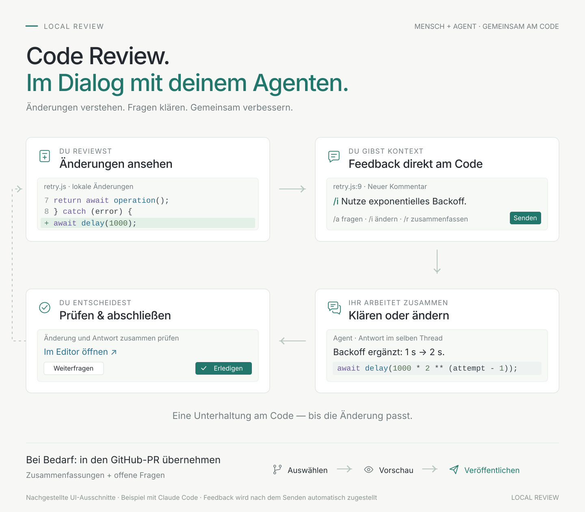

# Wie Local Review dein Feedback zu Claude bringt

**Claude muss nicht regelmäßig nach neuen Kommentaren fragen.** Im Standardbetrieb wartet ein kleiner lokaler Helfer im Hintergrund. Wenn du einen Kommentar sendest, erhält Claude dessen Inhalt automatisch über einen Hook. Die Antwort kommt über MCP in denselben VS-Code-Thread zurück.

## Der Weg eines Kommentars

Du schreibst an einer Codezeile oder Auswahl einen nativen Inline-Kommentar. `/a` bittet um eine Erklärung, `/i` um eine Änderung und `/r` um eine Zusammenfassung der Unterhaltung. Die Erweiterung wertet den Präfix beim Absenden aus. Ein ungesendeter Entwurf ist kein Auftrag an Claude.

Local Review speichert den Auftrag zunächst mit einer unveränderlichen Ereignis-ID, der Datei, dem ausgewählten Code, den Zeilen und dem umgebenden Kontext in VS Codes lokalem Workspace-Speicher. Erst nach erfolgreichem Speichern benachrichtigt es die verbundenen Komponenten. Der Codekontext bleibt erhalten, auch wenn sich die Datei später ändert. [Ereignisse und Speicherung](../src/store.ts) · [Codekontext im Auftrag](../src/eventPrompt.ts)

Der lokale Helfer hält eine Anfrage an die lokale Review-Verbindung offen. Sobald ein neuer Auftrag vorliegt, beendet die Erweiterung diese Anfrage mit den Daten. Der Helfer gibt das Feedback an den `asyncRewake`-Hook von Claude Code zurück. Claude erhält es an einem sicheren Verarbeitungspunkt; ein bereits laufendes Tool wird dadurch nicht abgebrochen. [Wartender Hook-Helfer](../src/hookWaiter.ts) · [Lokale Verbindung](../src/bridge.ts)

Claude bestätigt den Auftrag mit `acknowledge_review`, meldet den Arbeitsbeginn mit `set_review_working` und sendet seine Antwort mit `reply_to_review`. Diese MCP-Aufrufe aktualisieren das ursprüngliche Ereignis und dessen Thread. Eine hergestellte Verbindung allein bedeutet noch keine bestätigte Zustellung. **Nur du kannst den Thread als erledigt markieren.** [MCP-Werkzeuge](../src/channel.ts) · [Status und Antworten](../src/store.ts) · [Native VS-Code-Unterhaltung](../src/reviewController.ts)

## Ist das Push oder Polling?

Für dich ist es automatische Zustellung beim Senden. Technisch nutzt der Standardweg **Long Polling durch einen lokalen Hilfsprozess**; es ist kein wiederholtes Nachfragen des Sprachmodells.

| Beteiligter | Was er tut |
| --- | --- |
| VS-Code-Erweiterung | Speichert den gesendeten Auftrag und beantwortet eine wartende Anfrage sofort, wenn Arbeit vorhanden ist. |
| Lokaler Hook-Helfer | Fragt beim Start ausstehende Aufträge ab und wartet anschließend über `GET /events?after=0`. Ohne Arbeit bleibt die Anfrage bis zu 20 Sekunden offen; danach stellt er sie erneut. Neue Arbeit beendet die Wartezeit sofort. |
| Claude Code | Erhält das Feedback über den Hintergrund-Hook. Das Modell muss dafür keinen wiederkehrenden Prüfauftrag ausführen. |
| Lokaler MCP-Helfer | Stellt Werkzeuge für Bestätigung, Fortschritt und Antwort bereit. Im Standardmodus prüft er zusätzlich alle 15 Sekunden die lokale Verbindung; diese Prüfung ist kein Modellaufruf. |

Die 20 Sekunden sind eine Zeitgrenze für eine leere Warteanfrage, **kein festes Zustellintervall**. Die Erweiterung schließt offene Anfragen bei neuen gespeicherten Ereignissen unmittelbar. Wann Claude mit dem Feedback arbeitet, hängt zusätzlich von seiner laufenden Verarbeitung und dem nächsten sicheren Punkt ab. [Long Polling und Ereignisbenachrichtigung](../src/bridge.ts) · [Hook-Schleife und Wiederverbindung](../src/hookWaiter.ts) · [MCP-Verbindungsprüfung](../src/channel.ts)

Die Verbindung läuft authentifiziert über `127.0.0.1` auf deinem Rechner. Das ist die lokale Übergabe zwischen Erweiterung und Claude-Code-Prozess. Claude verwendet für die eigentliche Modellverarbeitung weiterhin seinen konfigurierten Anbieter. [Verbindungsprüfung](../src/connection.ts) · [Lokaler Server](../src/bridge.ts)

## Was die Verbindung startet

**Local Review: Mit Claude verbinden** startet oder setzt eine Claude-Code-Unterhaltung im integrierten VS-Code-Terminal fort und übergibt dafür erzeugte MCP- und Hook-Konfiguration. Eine bereits unabhängig gestartete Claude-Sitzung wird nicht automatisch verbunden. Die erzeugten Integrationsdateien liegen im Workspace-Speicher; die Erweiterung schreibt dafür keine Projektdateien wie `.claude/settings.json` oder `.mcp.json` um. [Start und Konfiguration](../src/setup.ts) · [Installation](INSTALL.md)

Die Hook-Konfiguration aktiviert den wartenden Helfer bei `SessionStart`, `UserPromptSubmit`, `PostToolUse` und `Stop`. Eine Sperre verhindert mehrere gleichzeitig aktive Wartehelfer für denselben Workspace. Ein Helfer kann bis zu 24 Stunden laufen. Falls er abläuft, verbindet ein Neustart oder eine neue Claude-Eingabe den Warteweg wieder. Gesendete Ereignisse bleiben lokal gespeichert. Die Zustellung kann nach Unterbrechungen wiederholt werden; Ereignis-IDs helfen bei der Zuordnung, ersetzen aber keine Garantie für exakt einmalige Codeänderungen. [Hook-Konfiguration](../src/setup.ts) · [Sperre und Wiederanlauf](../src/hookWaiter.ts) · [Gespeicherte Ereignisse](../src/store.ts)

Der alternative **Channels-Modus** verwendet Claude-Channel-Benachrichtigungen über MCP. Er ist ein ausdrücklich wählbarer experimenteller Weg und nicht die Standardverbindung der Grafik. Standardmäßig startet die Erweiterung den MCP-Helfer mit `--no-push` und verwendet den Hintergrund-Hook für neue Aufträge. [Transportwahl](../src/setup.ts) · [Channel-Benachrichtigungen](../src/channel.ts)

## Wie die Übergabe an einen GitHub-PR funktioniert

**An GitHub-PR übergeben** ist eine eigene Aktion. Sie findet den offenen PR des aktuellen Branches und bereitet einen Entwurf aus ausgewählten verfügbaren Zusammenfassungen und offenen Fragen vor. Du kannst den Text bearbeiten und als Markdown prüfen. Erst die ausdrückliche Veröffentlichungsaktion schreibt diesen Entwurf als gemeinsamen Kommentar in den PR. Spätere Übergaben aktualisieren den verwalteten Abschnitt dieses Kommentars. [PR-Übergabe](PR-HANDOFF.md) · [Entwurf erstellen](../src/prExport.ts) · [Vorschau und Veröffentlichung](../src/prExportController.ts)

`/r` veröffentlicht nichts auf GitHub. Die PR-Übergabe ist eine geprüfte Momentaufnahme und verändert weder die lokale Zustellbestätigung noch den Erledigt-Status deiner Threads.

## Zur Grafik

Die [SVG-Grafik](media/local-review-flow.svg) ist eigenständig und enthält keine externen Schriften oder Bilder. Eine daraus gerenderte [PNG-Version](media/local-review-flow.png) steht im README und im Installationspaket, weil VS Codes Paketprüfung SVG-Bilder im README ablehnt. Farben, großzügige Abstände und feine Linien orientieren sich an der gewünschten lokalen Präsentationsgestaltung; Marken, Logos und deren fachliche Inhalte wurden nicht übernommen. Die Schrift ist Arial beziehungsweise Helvetica mit einer normalen Sans-Serif-Ausweichschrift.

Stand: Architektur der Version 0.4, geprüft gegen die oben verlinkten Projektdateien. Die Darstellung erklärt den implementierten Ablauf; sie ist kein Nachweis einer bereits vollständig geprüften Live-Sitzung. Den aktuellen Prüfstand dokumentiert [REVIEW.md](REVIEW.md).
